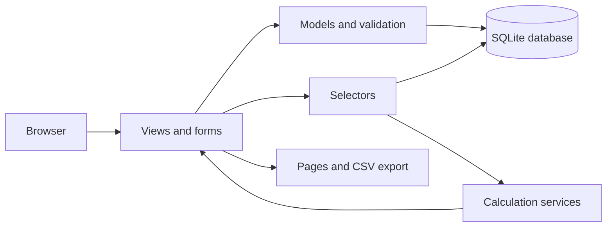

# Textile Production Intelligence

Textile Production Intelligence is an open-source application for recording production in textile and garment factories and turning those records into clear, traceable summaries.

## Overview

The application keeps production orders, batches, targets, actual output, downtime, rework and rejection in one place. It compares planned production with recorded output and shows where production fell short. Every figure on the dashboard and reports comes from saved records that you can open and check.

It runs on one Windows computer. It does not need machine connections, sensors, paid services or cloud hosting. It works with data entered by hand.

## Industrial Problem

In many factories, production records are spread across paper registers, spreadsheets and separate files. Each one may use different names, units and dates. Managers then find it hard to answer basic questions:

- Which orders are running, and how much is still left to produce?
- How much was planned for a batch or a day, and how much was actually made?
- Where did production stop, and for how long?
- How much output needed rework, and how much was rejected?
- Which orders or batches are behind their targets?

A summary is only useful if the records behind it are complete and consistent. Mixed units, missing targets and double-counted time can make a report look precise while being wrong.

## Proposed Solution

The application gives each kind of record its own form with checks built in. It rejects impossible entries, such as a negative quantity, an end time before a start time, or a batch that belongs to a different order.

All calculations use one shared set of rules. The dashboard, reports and CSV exports show the same numbers. When a figure cannot be calculated reliably, the screen says "Not available" and gives the reason. It does not show a zero.

## Key Capabilities

These features are implemented.

- **Production orders.** Record order ID, product or style, quantity, unit, planned dates and status (Planned, In progress, Completed, Cancelled).
- **Production batches.** Link batches to an order. A batch quantity is optional.
- **Production records.** Record the target (optional) and the actual output for a date, with the unit. Each record shows its own achievement and variance.
- **Downtime.** Record a start and end date and time. Duration is calculated from them. Events that cross midnight are handled correctly. Overlapping events are flagged.
- **Quality records.** Record rework and rejection as separate entries, each with a quantity, unit and optional reason.
- **Dashboard.** See target, actual output, achievement, variance, rework, rejection and downtime for any date range, order or batch.
- **Reports and CSV export.** Filter by date, order, batch, order status, downtime category and quality type. Export the summary or the downtime events to CSV.
- **Remaining quantity.** See how much of an order is left, based on recorded output. Output above the order quantity is flagged.
- **Orders to investigate.** The dashboard lists orders whose status and recorded output disagree.
- **Safe records.** Orders and batches with linked records cannot be deleted. Corrections are made by editing.
- **Demo data.** A command loads clearly labelled synthetic orders so you can try the application.
- **Backup and restore.** Two scripts back up and restore the database safely.

### What the main figures mean

| Figure | Meaning |
|---|---|
| Target achievement | Actual output divided by target, as a percentage. Only for records that have a target above zero. |
| Variance | Actual output minus target. A negative value means below target. |
| Remaining quantity | Order quantity minus recorded actual output in the order's own unit. |
| Sum of downtime durations | Adds every event. Overlapping time is counted more than once. |
| Unique elapsed downtime | Counts each minute of downtime once, even if events overlap. |

Recorded actual output is not treated as "acceptable" output. Rework and rejection are kept separate and are not subtracted from it. The assumptions behind these rules are listed in [docs/DOMAIN_RULES.md](docs/DOMAIN_RULES.md).

## How It Works

**Input.** A supervisor or data-entry operator saves records through the forms: orders, batches, production, downtime and quality.

**Process.** The application checks each record before saving it. When a page is opened, it adds up the saved records for the selected filters and applies the calculation rules. Different units are never added together.

**Output.** The dashboard and reports show the results. Each row has a link to the underlying records. Reports can be exported to CSV.

**Example.** An order is for 100 kg. Two production records for one batch have a target of 50 kg each. The actual output is 40 kg and 45 kg.

- Target: 100 kg
- Actual output: 85 kg
- Target achievement: 85.00%
- Variance: -15 kg

If one record has no target, its output is still counted in actual output. It is left out of achievement and variance, and a note says so.

## System Architecture

The application is a single Django web application with a SQLite database. Business rules sit in separate modules that do not depend on the web framework. This keeps the calculations easy to test.



| Part | Location | Purpose |
|---|---|---|
| Models | `production/models.py` | Data structure, constraints and cross-record checks. |
| Forms | `production/forms.py` | Input validation and filter forms. |
| Views | `production/views.py` | Pages, saving, deleting and CSV export. |
| Selectors | `production/selectors.py` | Filtered database queries and report assembly. |
| Services | `production/services/` | KPI, downtime, quality, status, unit and CSV rules. |
| Templates | `production/templates/`, `templates/` | The pages. |

## Technology Stack

| Technology | Use |
|---|---|
| Python 3.12 | Programming language. |
| Django 5.2 | Web framework, forms, database access and admin site. |
| SQLite | Local database. It is a single file. |
| HTML, CSS and a little JavaScript | Interface. No external libraries, fonts or CDNs are used. |
| pytest and pytest-django | Automated tests. |
| Ruff | Code style checks. |
| tzdata | Time zone data on Windows. |

## Installation & Setup

### Prerequisites

- Windows with Command Prompt or PowerShell.
- Python 3.12 from [python.org](https://www.python.org/downloads/). Tick "Add python.exe to PATH" and keep the `py` launcher.
- An internet connection for the one-time package installation.

### Quick setup

Open a terminal in the project folder and run:

```
scripts\setup.bat
scripts\check.bat
scripts\run.bat
```

In PowerShell, put `.\` before each script, for example `.\scripts\setup.bat`.

Then open <http://127.0.0.1:8000/>.

- `setup.bat` creates a virtual environment in `.venv`, installs the packages and creates the database.
- `check.bat` runs the tests, code style check, Django system check and migration check.
- `run.bat` starts the local server. Press Ctrl+C in that window to stop it.

### Manual setup

```
py -3.12 -m venv .venv
.venv\Scripts\activate
python -m pip install -r requirements-dev.txt
python manage.py migrate
python manage.py runserver 127.0.0.1:8000
```

In PowerShell, activate with `.venv\Scripts\Activate.ps1`.

### Configuration

The defaults work for local use. To change them, set environment variables before starting the server. In Command Prompt, use `set NAME=value`. See [.env.example](.env.example) for examples. The file is not read automatically.

| Variable | Default | Purpose |
|---|---|---|
| `DJANGO_TIME_ZONE` | `Asia/Kolkata` | Time zone for entering and showing date and time. |
| `DJANGO_DB_PATH` | `db.sqlite3` in the project folder | Database file location. |
| `DJANGO_DEBUG` | on | Set to `0` to turn debug mode off. |
| `DJANGO_SECRET_KEY` | built-in development key | Required when debug is off. |
| `DJANGO_ALLOWED_HOSTS` | `localhost,127.0.0.1,[::1]` | Hosts the server accepts. |
| `DJANGO_SECURE_COOKIES` | off | Set to `1` only when served over HTTPS. |

## Usage

1. Open **Production Orders** and choose **Add Order**. Enter the order ID, product, quantity and unit.
2. Open **Production Batches** and add a batch for that order.
3. Open **Production Records** and add the target (leave it blank if there is none), the actual output and the unit. A batch is optional.
4. Add **Downtime** with start and end times, and **Quality Records** for rework or rejection.
5. Open the **Dashboard** or **Reports** and choose a date range, order or batch.
6. Use the "View records" links to see the records behind any row.
7. To correct a mistake, open the record and choose **Edit**. The summaries update.

### Demo data

To try the application with example data:

```
python manage.py load_demo_data
```

This creates three orders with references starting `SYN-`. They are synthetic examples and not real factory data. A banner appears in the application while they exist. To remove only the demo data:

```
python manage.py load_demo_data --remove --yes
```

Without `--yes`, the command only shows what it would remove.

### Admin site

To add units of measure beyond the default `kg`, `m` and `pcs`:

```
python manage.py createsuperuser
```

Then sign in at <http://127.0.0.1:8000/admin/>.

### Backup and restore

```
python scripts\backup_db.py
python scripts\restore_db.py backups\<backup file> --yes
```

Stop the application before restoring. See [docs/BACKUP_AND_RESTORE.md](docs/BACKUP_AND_RESTORE.md).

### Tests

```
python -m pytest
ruff check .
python manage.py check
python manage.py makemigrations --check --dry-run
```

`scripts\check.bat` runs all four. Tests use a separate temporary database and fixed synthetic data.

## Project Structure

```
textile-production-intelligence/
├── config/              Django settings and URL setup
├── production/          The application
│   ├── models.py        Data structure and validation
│   ├── forms.py         Forms and filters
│   ├── views.py         Pages and CSV export
│   ├── selectors.py     Database queries and reports
│   ├── services/        Calculation and rule modules
│   ├── templates/       Application pages
│   ├── migrations/      Database setup
│   ├── management/      Demo data command
│   └── tests/           Automated tests
├── templates/           Base page layout, 404 and 500 pages
├── static/              CSS and JavaScript
├── scripts/             Setup, run, check, backup and restore
├── docs/                Domain rules, backup guide
├── requirements.txt     Runtime packages
└── requirements-dev.txt Runtime and test packages
```

## Current Status

This is an early release. The features listed under Key Capabilities are implemented.

- The maintainer has run the setup and check scripts on Windows.
- The calculation rules have automated tests with hand-calculated expected values.
- The application has not been tested with large amounts of data.
- It has not been checked in a formal accessibility review.
- It has not been validated in a working factory. Definitions such as downtime categories and the remaining-quantity rule are starting assumptions that need review by real users.

The application has no login. It is meant for trusted, local use. Do not put it on a public network or a shared server in its current form.

Not implemented: rework and rejection rates, shift-based reporting, efficiency or OEE measures, login and user roles, charts, and machine connections.

Rework and rejection rates are left out on purpose. The application does not record how many items were inspected, so there is no agreed base for a rate.

## Roadmap

These items are planned or under consideration. None of them exist yet.

- Login and user roles.
- A history of changes to records.
- Rework and rejection rates, once a base quantity is agreed.
- Shift-based reporting.
- Charts for trends over time.
- Importing records from CSV files.
- Guidance for running the application on a shared server, after login exists.

## Contributing

Contributions are welcome.

1. Fork the repository and create a branch.
2. Follow the Windows setup above.
3. Make your change. Keep calculation rules in `production/services/`, not in views or templates.
4. Add or update tests for any rule you change.
5. Run `scripts\check.bat` and fix any problems.
6. Open a pull request that explains what changed and why.

Please do not commit databases, backups or `.env` files. If you change a business rule, update [docs/DOMAIN_RULES.md](docs/DOMAIN_RULES.md).

## License

This project is released under the MIT License. See [LICENSE](LICENSE).
